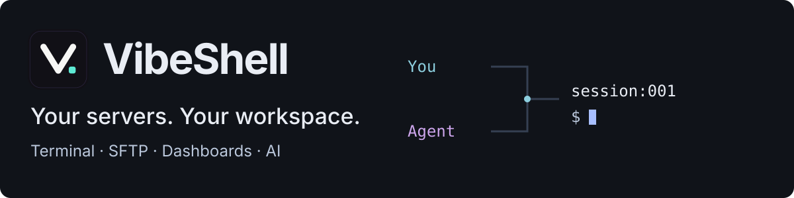
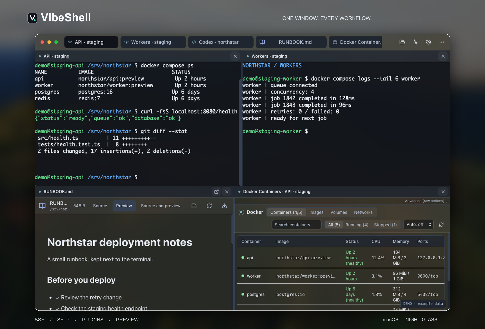
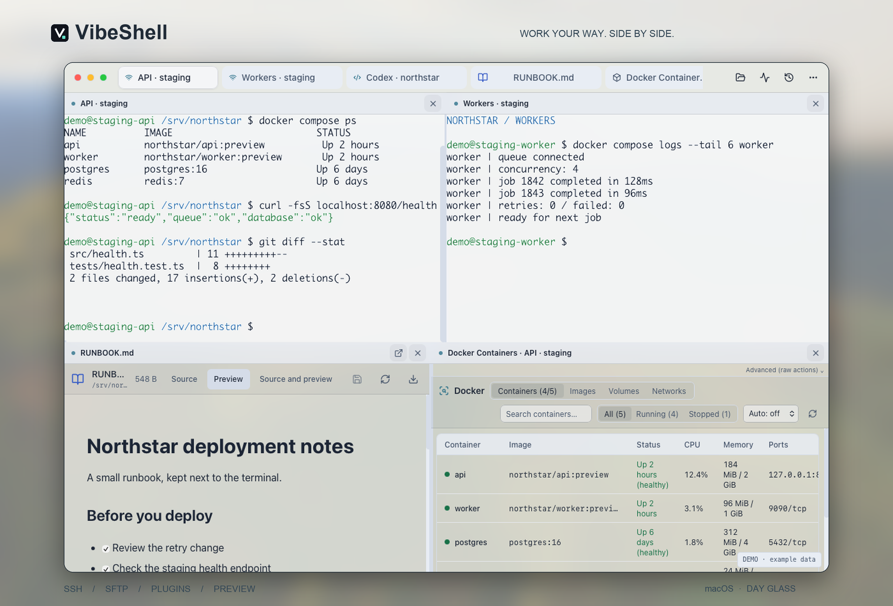
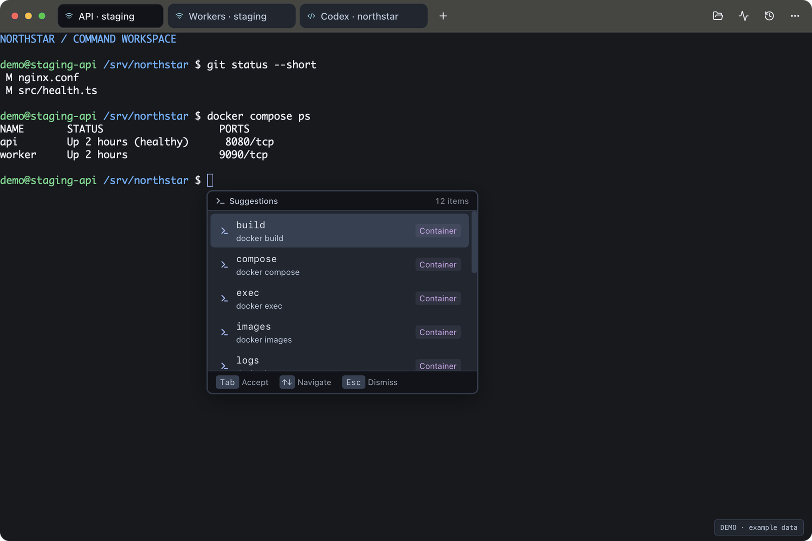
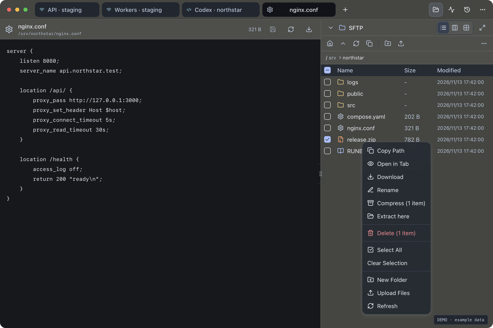
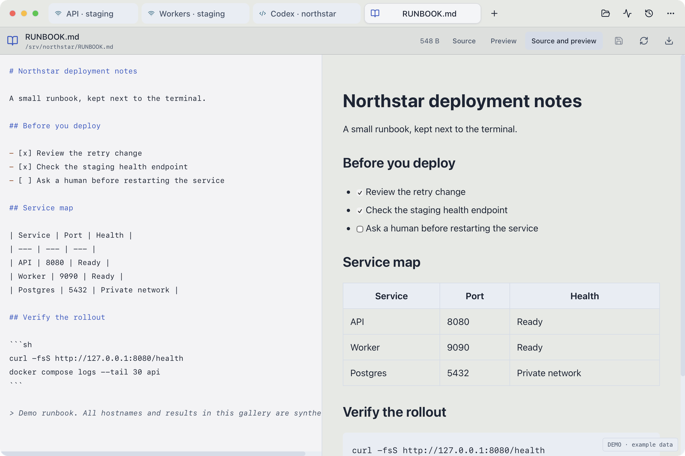
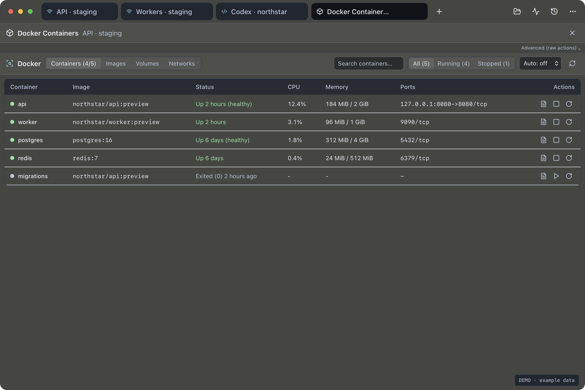
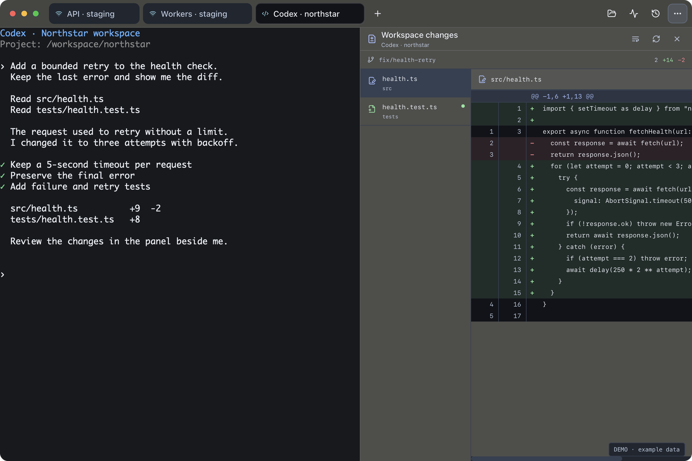
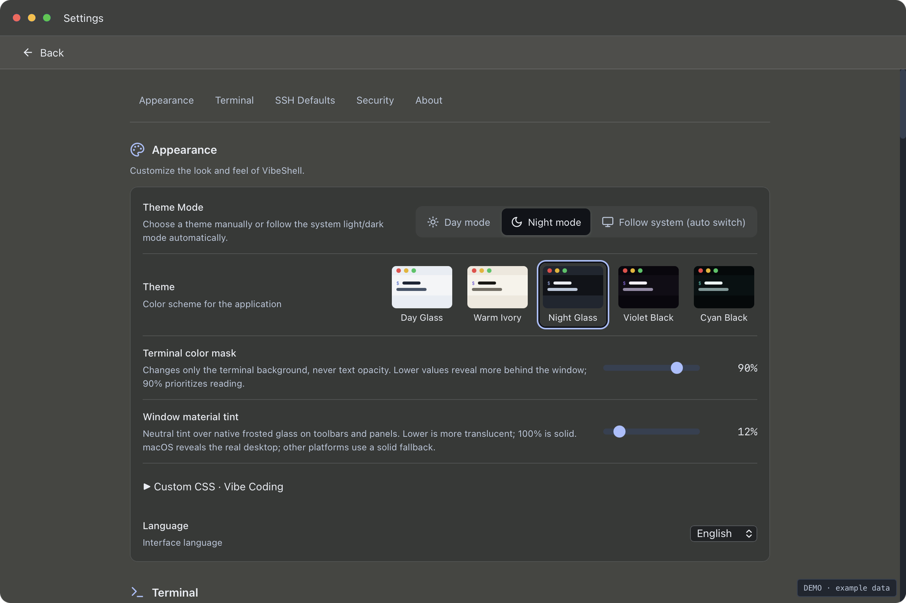

<p align="center">
  
</p>

<p align="center">
  <a href="README.md">English</a> · <a href="README.zh-CN.md">简体中文</a> · <a href="README.ja.md">日本語</a>
</p>
<p align="center">
  <a href="https://github.com/veithly/vibeshell/releases"></a>
  <a href="LICENSE"></a>
</p>
<p align="center">
  <a href="https://github.com/veithly/vibeshell/releases"><strong>ダウンロード</strong></a> · <a href="#start-here">はじめる</a> · <a href="cli/README.md">CLI ガイド</a> · <a href="docs/FEATURES.md">全機能</a>
</p>

<p align="center"><sub>応援するコミュニティ · <a href="https://linux.do">linux.do</a></sub></p>

**VibeShell は SSH、ローカルターミナル、SFTP、AI との共同作業をまとめるデスクトップワークスペースです。** ログを見ながら設定を編集し、入力中にコマンド候補を確認。ファイルを開いて編集、プレビュー、展開まで行えます。**一つのメインウィンドウ内に複数のターミナル、プラグイン、プレビューを並べられます。**



## 一つのウィンドウに、自由な作業ペイン

左側に二つの SSH ターミナル、右側に Markdown の手順書と Docker ダッシュボード。**すべて同じメインウィンドウ内の独立したペイン**なので、ページを切り替えずに同時に確認・操作できます。

- **異なるツールを混在配置。** SSH ターミナル、ローカル Shell、運用プラグイン、コードエディター、Markdown、ファイルプレビューを各ペインに表示できます。
- **ドラッグでレイアウトを構成。** タブを端へ移動して上下・左右に分割し、境界線でサイズを調整。最大九つのペインを組み合わせられます。
- **複数の作業を一度に確認。** 別々のサーバーの出力を見ながら設定を編集し、稼働状態を調べられます。
- **作業状態を保持。** 分割レイアウトは自動保存され、文書を移動しても未保存の編集内容を保持します。



[分割ペインの配置とレイアウト復元](docs/window-management.md)

## オプションを覚える手間も、入力し直す手間も減らす

コマンドのヘルプはカーソルの近くに。**コマンド、サブコマンド、オプション、履歴候補**を説明付きで表示し、あいまい検索と行内サジェストにも対応。よく使うコマンドは検索可能なスニペットにできます。

| ショートカット | 操作 |
| --- | --- |
| `Ctrl+Space` | 現在の入力に対する補完リストを開く・閉じる |
| `↑` / `↓` | 補完候補を選ぶ |
| `Tab` | 選択中の候補を入力する |
| `→` | 行内の後続候補を入力する |
| `Esc` | 補完リストを閉じる |



ローカル補完に AI アカウントは不要です。さらに柔軟な提案が必要なら、自分の OpenAI 互換または Claude エンドポイントで **AI コマンド予測**を有効にできます。提案を自動実行することはありません。有効時は入力内容と最近のコマンドの文脈が選択したサービスに送られます。

## SFTP で、その場で編集・プレビュー・展開

フォルダーアイコンから接続先のファイルを開きます。**ダブルクリックで編集タブを開き、変更をサーバーへ直接保存。** ダウンロード、別のエディターで編集、再アップロードという往復を自分で管理する必要がありません。

| やりたいこと | VibeShell でできること |
| --- | --- |
| 設定・スクリプト・コードを変更 | 独立した編集タブ、構文強調、`⌘/Ctrl+S` 保存 |
| README や手順書を読む | Markdown のソース、プレビュー、左右並列表示 |
| 画像・PDF・音声・動画を確認 | ファイルタブでプレビュー。対応形式はプラットフォームによる |
| アーカイブの中身を先に確認 | ZIP、TAR、TAR.GZ のエントリー一覧 |
| 配布ファイルをリモートで展開 | アーカイブを選び、右クリックの **Extract here** で現在のサーバーディレクトリに展開 |
| 複数ファイルをまとめる | 複数選択して `.tar.gz` または `.zip` に圧縮 |
| ファイルを整理・転送 | 詳細・カラム・アイコン表示、複数選択、パスコピー、名前変更、フォルダー作成、アップロード・ダウンロード |
| プロジェクトのディレクトリを同期 | 除外ルール、ネストした `.gitignore`、余分なリモートファイルの任意削除 |



リモート展開は一般的な TAR、ZIP、GZ、BZ2、XZ、7z、RAR に対応し、サーバー上の対応ツールを利用します。**アーカイブ内容のプレビューとリモート展開は別の機能です。**

ローカル文書も **⌘/Ctrl+O** で開けます。ペインを移動しても下書きは保たれ、ローカル保存時には外部からの変更を確認します。手元のメモとリモート設定を同じワークスペースで扱えます。

<details>
<summary>Markdown のソースとプレビューを並べて見る</summary>



</details>

## 性能はターミナルの下に、詳細はダッシュボードに

性能アイコンをクリックすると、**CPU、メモリー、ディスク、ネットワークのパネルがターミナルの下に開きます**。実行中のコマンドを見たまま確認し、境界線で高さを変更、再クリックで閉じられます。

詳しく調べるときは現在のセッションでツールを開きます。Docker のログ、データベース、待ち受けポート、サービス、定期実行タスクを確認できます。

| 組み込みツール | よく使う機能 |
| --- | --- |
| Server Performance | リソース使用量、負荷、稼働時間、定期更新 |
| Docker Containers | 稼働・停止フィルター、使用量、ログ、inspect、起動・停止・再起動、単発 exec |
| Kubernetes | コンテキスト、Pod、Deployment、イベント、ログ、describe |
| Database Inspector | PostgreSQL・MySQL・SQLite のメタデータとクエリ |
| Redis Inspector | キー検索、値、型、TTL、クライアント、slowlog、設定 |
| Process Explorer | CPU・メモリー順の表示、詳細、プロセス終了 |
| System Logs | 最近の journal とサービスログ |
| Network Inspector | 待ち受けソケット、経路、インターフェース、DNS |
| Disk Usage | ファイルシステムとディレクトリの使用量 |
| Git Workspace | 状態、ブランチ、コミット履歴 |
| Scheduled Tasks | cron、systemd timers、ユーザー crontab 編集 |
| Systemd Services | 状態、起動、停止、再起動 |



この **12 種類の組み込みプラグイン**は CLI と MCP からも Agent が検出・利用できます。マーケットプレイスでは宣言的 JSON プラグインをインポート可能。各操作には接続先のプログラムと権限が必要です。[プラグイン参考](docs/FEATURES.md#operations-plugins)

<a id="shared-sessions"></a>
## Agent と同じ作業の続きを進める

ログ調査を Agent に頼むたびに、出力を別の会話へコピーする必要はありません。VibeShell CLI で既存セッションを利用し、**コマンドと出力は自分のターミナルにも表示されます**。`cd` や `export` の文脈を維持し、`--new` を明示したときだけ別の Shell を開きます。

**誰が何をしたかが分かる履歴。** User と Agent（CLI）を色分けし、各記録から対象セッションへ移動できます。Agent が新しく接続しても別タブが追加されるだけで、今見ているタブのフォーカスを奪いません。

ローカル開発では **Claude Code、Codex、OpenCode、Pi** を起動できます。プロジェクトとタスク、対応する起動モードを選び、**Workspace changes** でブランチと変更ファイル、行単位の差分を確認。ツールのインストール、ログイン、契約は自分のものを使います。



確認が必要なコマンドは理由とともに承認画面へ表示され、続行するかを選べます。通常の SSH、ファイル管理、運用機能だけでも利用可能です。[Agent Skill](skills/vibeshell/SKILL.md) · [共同作業ガイド](docs/AGENT_COLLABORATION.md)

## 毎日の繰り返し作業を、もっと手軽に

**IP アドレスより名前で探す。** 保存済みサーバーを検索し、グループとタグで整理。OpenSSH・PuTTY・Tabby の設定インポート、踏み台、ログイン後コマンドにも対応。既存セッションへ戻る操作と新規接続は分かれています。

**繰り返す設定を保存。** コマンドスニペットを分類し、ローカル・リバース・SOCKS5 転送設定を保存。SSH 出力をローカルログに記録できます。

**別の環境にも設定を持ち運ぶ。** 任意の GitHub Gist / WebDAV 暗号化同期と、ポータブルファイルのインポート・エクスポートでサーバー情報、グループ、スニペット、プラグイン記録を移行。ログイン認証情報は端末内に残ります。

**使い方に合わせる外観。** ライト・ダーク・システム連動、フォントとカーソル、ターミナル背景とウィンドウの濃度を個別調整。macOS ではネイティブの半透明マテリアルを使い、独自 CSS のプレビュー・インポート・保存もできます。

<details>
<summary>最新の外観設定を見る</summary>



</details>

<a id="start-here"></a>
## はじめる

[Releases](https://github.com/veithly/vibeshell/releases) から環境に合う版をダウンロードしてください。

| プラットフォーム | デスクトップ | 単体 CLI |
| --- | --- | --- |
| macOS Apple Silicon / Intel | `.dmg` | アーキテクチャ別 `.tar.gz` |
| Windows x64 | `.exe` / `.msi` | `.zip` |
| Linux x64 | `.AppImage` / `.deb` | `.tar.gz` |

デスクトップでは **＋ → SSH** でサーバーを追加・選択し、初回のホスト指紋を確認して接続します。**Local Shell** と **Coding Agent** も同じ新規セッション入口から選べます。

ネイティブ CLI は Node.js 不要で、デスクトップのない環境でも動作します。インストール後、既存設定をインポートして接続先を選びます。

```bash
vibeshell import auto --dry-run
vibeshell import auto
vibeshell servers
vibeshell ssh staging
```

`staging` は保存済みのサーバー名へ置き換えます。`sessions` が返す別名で同じセッションを続けて使えます。

```bash
vibeshell sessions
vibeshell ssh-session 001 -- pwd
vibeshell sftp --session 001 ls /srv/app
vibeshell plugins list --installed --json
```

[CLI のインストールとコマンド](cli/README.md) · [機能・プラットフォーム詳細](docs/FEATURES.md) · [変更履歴](CHANGELOG.md)

<a id="development"></a>
## 開発とコントリビューション

Node.js 22.12+、安定版 Rust、[Tauri の前提環境](https://v2.tauri.app/start/prerequisites/)を用意します。

```bash
git clone --branch dev https://github.com/veithly/vibeshell.git
cd vibeshell
npm ci
npm run tauri -- dev
```

通常の PR は `dev` 向けに作成します。ビルド、テスト、リリース手順は[コントリビューションガイド](CONTRIBUTING.md)と[リリースガイド](docs/RELEASING.md)にあります。

[全機能](docs/FEATURES.md) · [ウィンドウ管理](docs/window-management.md) · [ファイルとテーマ](docs/local-files-and-css-themes.md) · [プラグイン開発](docs/plugin-development.md) · [セキュリティ報告](https://github.com/veithly/vibeshell/security/advisories/new)

*画像は最新の開発 UI とサンプルデータを使用しています。公開ビルドの機能は各リリースノートをご覧ください。[画像と再現方法](assets/readme/README.md)。*

## ライセンス

**GPL-3.0-only**。[LICENSE](LICENSE)、[NOTICE](NOTICE)、[保存された MIT 表記](licenses/legacy-MIT.txt)を参照してください。
