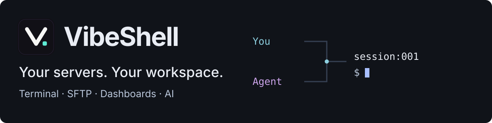
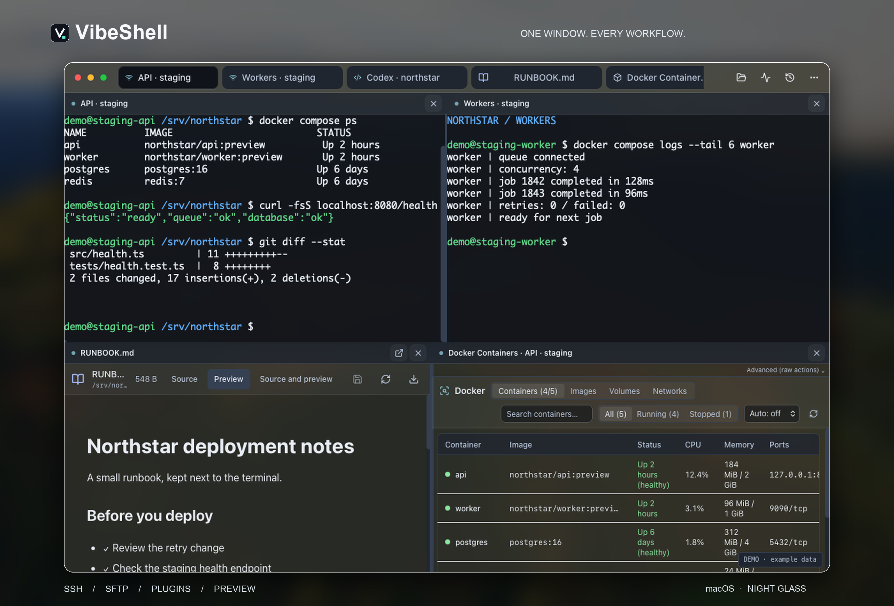
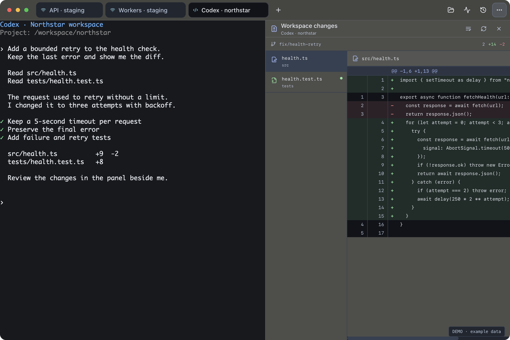
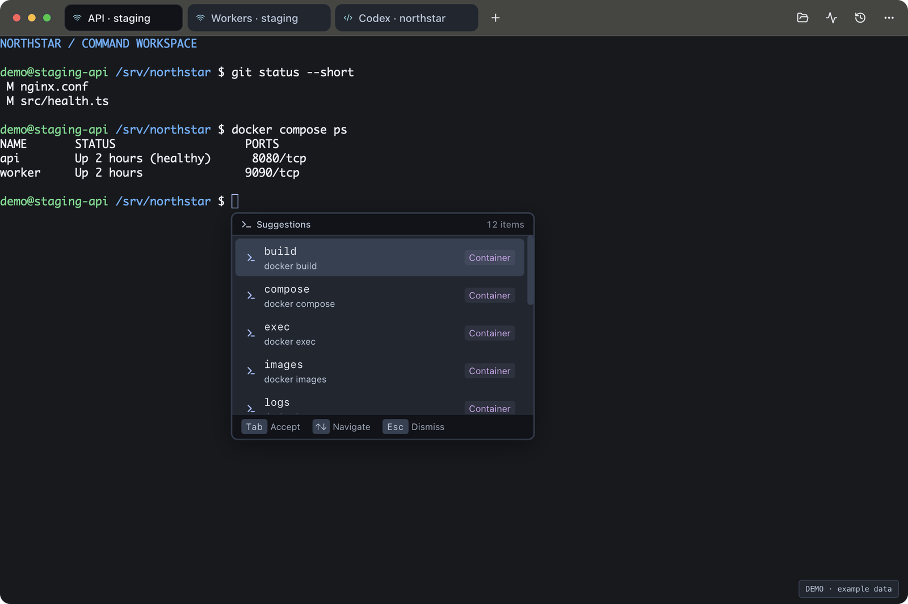
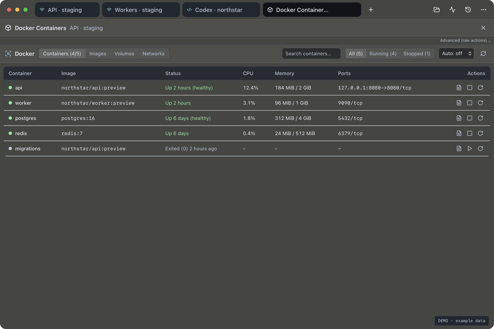
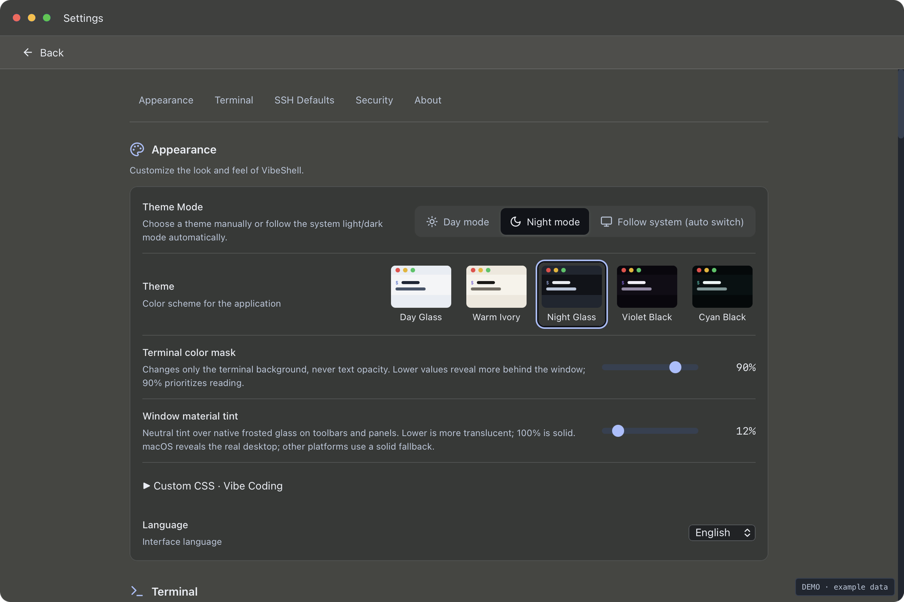

<p align="center">
  
</p>

<p align="center">
  <a href="README.md">English</a> · <a href="README.zh-CN.md">简体中文</a> · <a href="README.ja.md">日本語</a>
</p>
<p align="center">
  <a href="https://github.com/veithly/vibeshell/releases"></a>
  <a href="LICENSE"></a>
</p>
<p align="center">
  <a href="https://github.com/veithly/vibeshell/releases"><strong>Download</strong></a> · <a href="#ai-integration">Connect your AI</a> · <a href="#ssh-workspace">SSH workspace</a> · <a href="#start-here">Quick start</a> · <a href="cli/README.md">CLI guide</a> · <a href="docs/FEATURES.md">All features</a>
</p>

<p align="center"><sub>Community we support · <a href="https://linux.do">linux.do</a></sub></p>

**SSH that fits your AI tools—and feels great in your own hands.**

VibeShell brings server management, SSH sessions, SFTP and operations plugins into one workflow. Connect Claude Code, Codex, Cursor and other agents through a Skill and native CLI to work with your saved servers. Watch their work in the same workspace, and take over yourself whenever needed.

**Delegate without shuttling commands and output between chats. Work hands-on without juggling a terminal, file-transfer client and monitoring tools.**



<a id="ai-integration"></a>
## Give the AI you already use a real SSH workspace

### Connect your existing tools, not another chat client

Keep your AI workflow. Install the **VibeShell Skill** so your agent can use the native CLI to discover saved servers, reuse SSH sessions, investigate logs, read and edit remote files, transfer directories, and discover and run operations plugins.

Built-in Skill installation targets include **Claude Code, Codex, Cursor, OpenCode, Pi, Gemini CLI and Windsurf**, among others. Keep your own tool, login and model configuration. VibeShell handles the server connection, so you do not need to paste SSH passwords or private keys into a conversation.

After installing VibeShell, select your tool under **Settings → Skills**, or check and install from the CLI. For example, to connect Claude Code:

```bash
vibeshell version
vibeshell tools
vibeshell install claude-code
```

Use the ID returned by `tools` for another client, such as `codex`, `cursor` or `opencode`; `vibeshell install all` installs for detected tools in one pass. Once the client has loaded the Skill, try a task like:

> Use VibeShell to inspect the saved staging server. Reuse an existing session, check service status and recent error logs, and report your findings before making changes. Do not restart any services.

For protocol-level integrations, a local **MCP gateway** also exposes session, file and plugin tools. The native CLI can run without the desktop and does not require Node.js. [Integration and collaboration](docs/AGENT_COLLABORATION.md) · [Agent Skill](skills/vibeshell/SKILL.md) · [CLI guide](cli/README.md)

<a id="shared-sessions"></a>
### See what your agent does. Pick up where it leaves off.

**No separate, invisible terminal to lose track of.** With CLI `ssh` / `ssh-session`, your agent can reuse the interactive SSH session you are working in. Commands and output remain visible in the desktop terminal, and `cd` / `export` context carries forward. Use `--new` when an independent parallel shell is intentional.

History distinguishes **User** input from **Agent (CLI)** operations by color, with a link back to each session. Agent-created connections become separate tabs without taking focus away from your work. Start investigating yourself, ask an agent to continue, then pick up the same terminal when you need to.

Guarded Gateway operations that require confirmation enter an approval flow. Independent MCP and plugin execution is distinct from the shared interactive shell; see the [collaboration guide](docs/AGENT_COLLABORATION.md) for context and permission rules.

### Keep coding agents, terminals and code review together

For local development, use **＋ → Coding Agent** to launch **Claude Code, Codex, OpenCode or Pi** with a project, task and supported start mode. Open **Workspace changes** alongside it to inspect the Git branch, modified files and line-by-line diff. Keep SSH terminals and remote files in the same workspace as you move between development and operations.



<a id="ssh-workspace"></a>
## A daily-driver SSH terminal, even without AI

**AI adds to the workflow; it is not a requirement.** Multi-session SSH, connection management, SFTP, command completion, operations panels and tunnels work independently. Connect to servers, edit configurations and inspect logs without setting up a model or AI account.

**Manage servers, not a list of IP addresses.** Search saved connections by name, organize environments with groups and tags, and import OpenSSH, PuTTY or Tabby profiles, including supported jump-host settings. Returning to an existing session and opening a new connection have separate actions, so you do not have to enter connection details again each time.

### One window. As many work panes as the task needs.

Keep two SSH terminals visible on one side, with a Markdown runbook and Docker dashboard on the other. **Each area is a pane inside the same main app window**, so you can watch and use several tools at once.

- **Mix different tools.** Place an SSH terminal, local shell, operations plugin, code editor, Markdown document or file preview in each pane.
- **Compose the layout by dragging.** Drop tabs at pane edges to split left/right or top/bottom, resize dividers, and arrange up to nine panes.
- **Work across sessions at a glance.** Watch output from different servers while editing a config or inspecting the host's status.
- **Keep your place.** Layouts save automatically, and unsaved document edits survive rearranging panes.


[Composing and restoring split-pane layouts](docs/window-management.md)

### Remember fewer flags. Retype fewer commands.

Command help belongs near the cursor. VibeShell suggests **commands, subcommands, options and command-history matches**, with descriptions, fuzzy matching and inline suggestions. Save frequently used commands as searchable snippets.

| Shortcut | Action |
| --- | --- |
| `Ctrl+Space` | Open or close completion for the current input |
| `↑` / `↓` | Move through completion candidates |
| `Tab` | Accept the selected completion |
| `→` | Accept an inline suffix suggestion |
| `Esc` | Dismiss the completion list |



Local completion needs no AI account. For additional suggestions, enable **AI command prediction** with your own OpenAI-compatible or Claude endpoint. Suggestions never execute automatically; enabling prediction sends your input and recent command context to the provider you choose.

### SFTP: edit, preview and extract where the files live

Open the folder icon to browse the connected server. **Double-click a file, edit it in a workspace tab and save directly back to the server.** No download–edit–upload round trip to manage yourself.

| What you need | What you can do in VibeShell |
| --- | --- |
| Change a config, script or source file | Dedicated editor tabs, syntax highlighting and `⌘/Ctrl+S` |
| Read a README or runbook | Markdown source, preview, or both side by side |
| Inspect images, PDFs, audio and video | Preview in a file tab, with format support provided by the platform |
| Check an archive before opening it | Browse the entries in ZIP, TAR and TAR.GZ files |
| Unpack a deployment archive | Select the archive and choose **Extract here** in the server's current directory |
| Bundle several files | Multi-select and compress to `.tar.gz` or `.zip` |
| Organize and transfer files | Details, column and icon views; multi-select, copy paths, rename, create folders, upload and download |
| Sync a project directory | Exclusion rules, nested `.gitignore` handling and optional removal of extra remote files |


Remote extraction supports common TAR, ZIP, GZ, BZ2, XZ, 7z and RAR formats through the corresponding tools installed on the server. **Archive-content preview and remote extraction are separate features.**

Local documents work here too: press **⌘/Ctrl+O** without connecting to SSH. Drafts survive rearranging panes, and local saves check for external edits to help prevent accidental overwrites. Keep your local notes beside the remote configuration they describe.

<details>
<summary>See Markdown source and preview side by side</summary>


</details>

### Performance below the terminal. Details in a dashboard.

Click the performance icon and **CPU, memory, disk and network panels open beneath your terminal**. Keep the command in view, drag to adjust the panel height, and click again to hide it.

For a closer look, open a tool for the current session: inspect Docker logs, explore a database, check listening ports, or manage services and scheduled jobs.

**Open a container as its own terminal.** From an SSH session, choose **More → Docker containers** and select a running container. Its terminal, native CLI, MCP and plugin commands stay in that container; stopped containers stay stopped. Settings also provides HTTP/HTTPS/SOCKS outbound routing and a persistent Agent Gateway port. [Setup and supported scope](docs/NETWORK_AND_CONTAINERS.md).

<details>
<summary>Explore all 12 built-in operations plugins</summary>

| Built-in tool | Useful actions |
| --- | --- |
| Server Performance | Resource usage, load, uptime and periodic refresh |
| Docker Containers | Running/stopped filters, usage, logs, inspect, start/stop/restart and one-shot exec |
| Kubernetes | Contexts, pods, deployments, events, logs and describe |
| Database Inspector | PostgreSQL, MySQL and SQLite metadata and queries |
| Redis Inspector | Key lookup, values, types, TTL, clients, slowlog and configuration |
| Process Explorer | CPU/memory sorting, process details and termination |
| System Logs | Recent journal entries and service logs |
| Network Inspector | Listening sockets, routes, interfaces and DNS |
| Disk Usage | Filesystem capacity and directory usage |
| Git Workspace | Status, branches and commit history |
| Scheduled Tasks | Cron, systemd timers and user crontab editing |
| Systemd Services | Status, start, stop and restart |

</details>



The same **12 built-ins** are discoverable by agents through the CLI and MCP. Import declarative JSON plugins through the marketplace to add your own tools. Actions use the programs and permissions available on the target host; see the [plugin references](docs/FEATURES.md#operations-plugins) for dependencies.

### The small conveniences that add up every day

**Save the repetitive setup.** Organize command snippets by category and tags. Save local, reverse and SOCKS5 forwarding configurations. Record SSH terminal output to local logs.

**Take your configuration with you.** Optional encrypted GitHub Gist/WebDAV sync and portable-file import/export carry server metadata, groups, snippets and plugin records between setups. Login credentials stay on the device.

**Set it up for the way you work.** Light, dark and system appearance; terminal fonts and cursors; separate controls for terminal background and window tint. macOS has native frosted translucency. Plugin lists, dashboards, settings and menus share a continuous glass material with monochrome interface accents, while terminal and code colors remain distinct. Custom CSS can be previewed, imported and saved.

<details>
<summary>See the latest appearance settings</summary>



</details>

<a id="start-here"></a>
## Get started

Download your platform's build from [Releases](https://github.com/veithly/vibeshell/releases):

| Platform | Desktop | Standalone CLI |
| --- | --- | --- |
| macOS Apple Silicon / Intel | `.dmg` | Architecture-specific `.tar.gz` |
| Windows x64 | `.exe` / `.msi` | `.zip` |
| Linux x64 | `.AppImage` / `.deb` | `.tar.gz` |

In the desktop app, choose **＋ → SSH**, add or select a server, and verify its fingerprint on first connection. **Local Shell** and **Coding Agent** are available from the same new-session entry.

Ready to bring your AI along? After configuring a server, follow [Connect your AI](#ai-integration) to install the Skill and let it use those saved targets and sessions.

The native CLI needs no Node.js and also works on headless machines. After installation, import existing profiles and choose a server:

```bash
vibeshell import auto --dry-run
vibeshell import auto
vibeshell servers
vibeshell servers add user@host --name staging --identity ~/.ssh/id_ed25519
vibeshell ssh staging
```

Replace `staging` with your saved server name. Continue in the same session using the alias returned by `sessions`:

```bash
vibeshell sessions
vibeshell ssh-session 001 -- pwd
vibeshell sftp --session 001 ls /srv/app
vibeshell plugins list --installed --json
```

[CLI installation and commands](cli/README.md) · [Feature and platform details](docs/FEATURES.md) · [Changelog](CHANGELOG.md)

### Teleport nodes

The development branch supports Teleport profiles in the desktop and native `vibeshell` CLI. Log in with `tsh`, add a node with `vibeshell servers add alice@node --type teleport --proxy proxy.example:443`, and use the same terminal, command and file workflows. File operations require a standard external SFTP server on the node; unsupported configurations fail explicitly. [Setup and supported scope](docs/TELEPORT.md).

<a id="development"></a>
## Develop and contribute

Use Node.js 22.12+, stable Rust and the [Tauri platform prerequisites](https://v2.tauri.app/start/prerequisites/).

```bash
git clone --branch dev https://github.com/veithly/vibeshell.git
cd vibeshell
npm ci
npm run tauri -- dev
```

Open normal PRs against `dev`. Build, testing and release instructions are in [Contributing](CONTRIBUTING.md) and [Releasing](docs/RELEASING.md).

[All features](docs/FEATURES.md) · [Window management](docs/window-management.md) · [Files and themes](docs/local-files-and-css-themes.md) · [Plugin development](docs/plugin-development.md) · [Report a security issue](https://github.com/veithly/vibeshell/security/advisories/new)

*Screenshots show the latest development UI with example data; release notes describe each published build. [Image sources and reproduction](assets/readme/README.md).*

## License

**GPL-3.0-only**. See [LICENSE](LICENSE), [NOTICE](NOTICE) and the [preserved MIT notice](licenses/legacy-MIT.txt).
