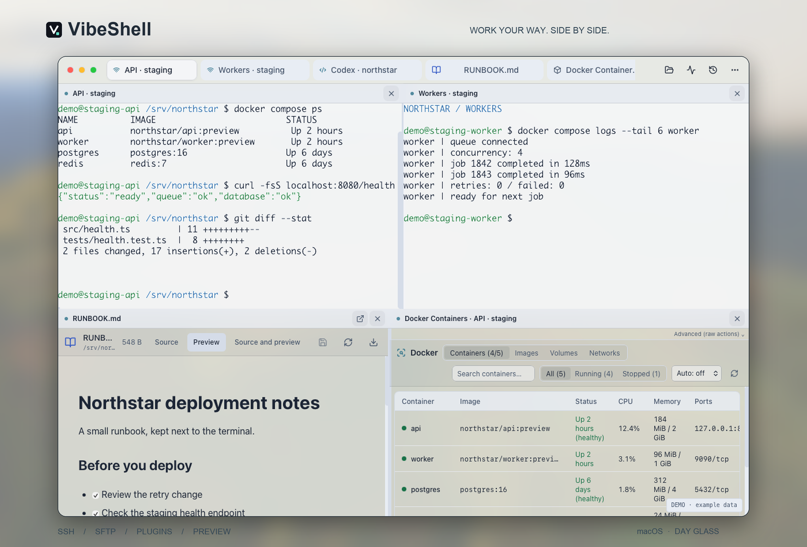
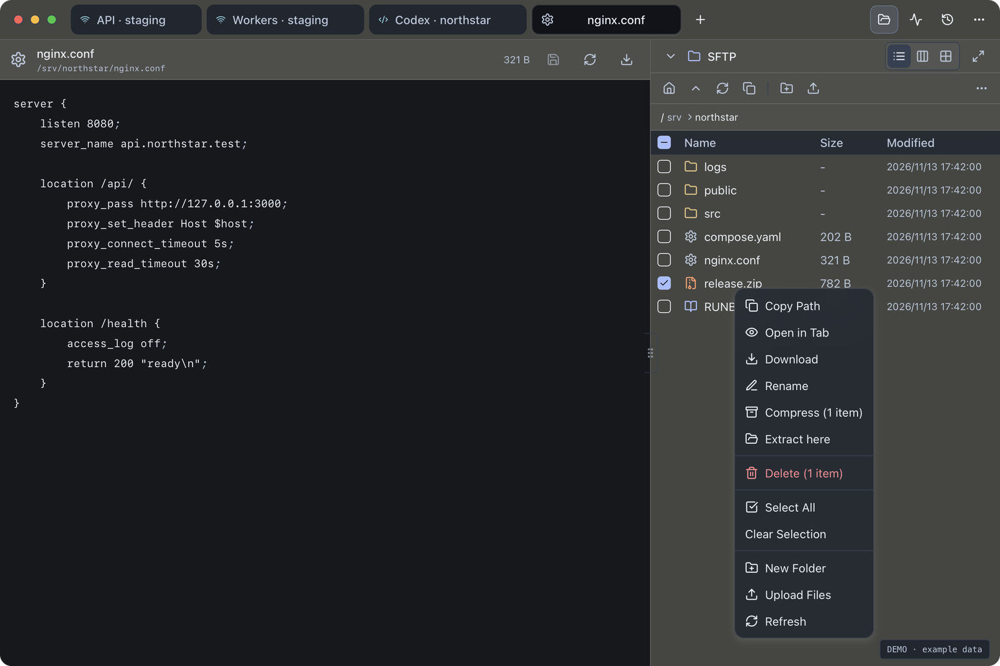
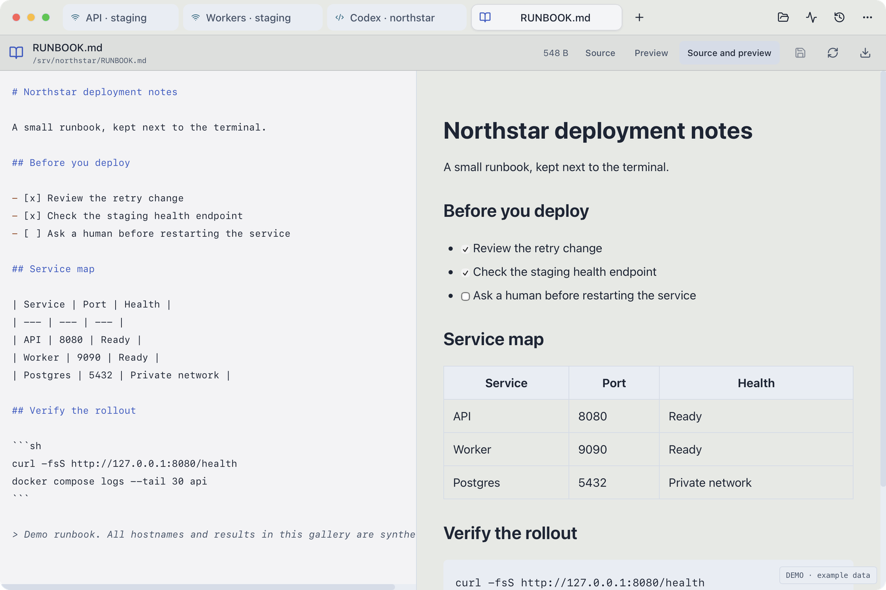

<p align="center">
  
</p>

<p align="center">
  <a href="README.md">English</a> · <a href="README.zh-CN.md">简体中文</a> · <a href="README.ja.md">日本語</a>
</p>
<p align="center">
  <a href="https://github.com/veithly/vibeshell/releases"></a>
  <a href="LICENSE"></a>
</p>
<p align="center">
  <a href="https://github.com/veithly/vibeshell/releases"><strong>Download</strong></a> · <a href="#start-here">Quick start</a> · <a href="cli/README.md">CLI guide</a> · <a href="docs/FEATURES.md">All features</a>
</p>

<p align="center"><sub>Community we support · <a href="https://linux.do">linux.do</a></sub></p>

**VibeShell brings SSH, local terminals, SFTP and AI collaboration into one desktop workspace.** Watch logs while editing a configuration. Get suggestions as you type. Open a file to edit, preview or extract it. **Arrange multiple terminals, plugins and previews inside one main window**, without switching between disconnected pages.


## One window. As many work panes as the task needs.

Keep two SSH terminals visible on one side, with a Markdown runbook and Docker dashboard on the other. **Each area is a pane inside the same main app window**, so you can watch and use several tools at once.

- **Mix different tools.** Place an SSH terminal, local shell, operations plugin, code editor, Markdown document or file preview in each pane.
- **Compose the layout by dragging.** Drop tabs at pane edges to split left/right or top/bottom, resize dividers, and arrange up to nine panes.
- **Work across sessions at a glance.** Watch output from different servers while editing a config or inspecting the host's status.
- **Keep your place.** Layouts save automatically, and unsaved document edits survive rearranging panes.



[Composing and restoring split-pane layouts](docs/window-management.md)

## Remember fewer flags. Retype fewer commands.

Command help belongs near the cursor. VibeShell suggests **commands, subcommands, options and command-history matches**, with descriptions, fuzzy matching and inline suggestions. Save frequently used commands as searchable snippets.

| Shortcut | Action |
| --- | --- |
| `Ctrl+Space` | Open or close completion for the current input |
| `↑` / `↓` | Move through completion candidates |
| `Tab` | Accept the selected completion |
| `→` | Accept an inline suffix suggestion |
| `Esc` | Dismiss the completion list |


Local completion needs no AI account. For additional suggestions, enable **AI command prediction** with your own OpenAI-compatible or Claude endpoint. Suggestions never execute automatically; enabling prediction sends your input and recent command context to the provider you choose.

## SFTP: edit, preview and extract where the files live

Open the folder icon to browse the connected server. **Double-click a file, edit it in a workspace tab and save directly back to the server.** No download–edit–upload round trip to manage yourself.

| What you need | What you can do in VibeShell |
| --- | --- |
| Change a config, script or source file | Dedicated editor tabs, syntax highlighting and `⌘/Ctrl+S` |
| Read a README or runbook | Markdown source, preview, or both side by side |
| Inspect images, PDFs, audio and video | Preview in a file tab, with format support provided by the platform |
| Check an archive before opening it | Browse the entries in ZIP, TAR and TAR.GZ files |
| Unpack a deployment archive | Select the archive and choose **Extract here** in the server's current directory |
| Bundle several files | Multi-select and compress to `.tar.gz` or `.zip` |
| Organize and transfer files | Details, column and icon views; multi-select, copy paths, rename, create folders, upload and download |
| Sync a project directory | Exclusion rules, nested `.gitignore` handling and optional removal of extra remote files |



Remote extraction supports common TAR, ZIP, GZ, BZ2, XZ, 7z and RAR formats through the corresponding tools installed on the server. **Archive-content preview and remote extraction are separate features.**

Local documents work here too: press **⌘/Ctrl+O** without connecting to SSH. Drafts survive rearranging panes, and local saves check for external edits to help prevent accidental overwrites. Keep your local notes beside the remote configuration they describe.

<details>
<summary>See Markdown source and preview side by side</summary>



</details>

## Performance below the terminal. Details in a dashboard.

Click the performance icon and **CPU, memory, disk and network panels open beneath your terminal**. Keep the command in view, drag to adjust the panel height, and click again to hide it.

For a closer look, open a tool for the current session: inspect Docker logs, explore a database, check listening ports, or manage services and scheduled jobs.

| Built-in tool | Useful actions |
| --- | --- |
| Server Performance | Resource usage, load, uptime and periodic refresh |
| Docker Containers | Running/stopped filters, usage, logs, inspect, start/stop/restart and one-shot exec |
| Kubernetes | Contexts, pods, deployments, events, logs and describe |
| Database Inspector | PostgreSQL, MySQL and SQLite metadata and queries |
| Redis Inspector | Key lookup, values, types, TTL, clients, slowlog and configuration |
| Process Explorer | CPU/memory sorting, process details and termination |
| System Logs | Recent journal entries and service logs |
| Network Inspector | Listening sockets, routes, interfaces and DNS |
| Disk Usage | Filesystem capacity and directory usage |
| Git Workspace | Status, branches and commit history |
| Scheduled Tasks | Cron, systemd timers and user crontab editing |
| Systemd Services | Status, start, stop and restart |


The same **12 built-ins** are discoverable by agents through the CLI and MCP. Import declarative JSON plugins through the marketplace to add your own tools. Actions use the programs and permissions available on the target host; see the [plugin references](docs/FEATURES.md#operations-plugins) for dependencies.

<a id="shared-sessions"></a>
## Pick up where your agent left off

Ask an agent to investigate a log without copying terminal output into another conversation. Through VibeShell's CLI it can use the existing session, while **its commands and output remain visible in your terminal**. Your `cd` and `export` context carries forward; `--new` explicitly opens another shell.

**Know who did what.** History distinguishes User input from Agent (CLI) operations with different colors and a link to each session. An agent-created connection becomes a separate tab without taking focus away from your work.

For local development, launch **Claude Code, Codex, OpenCode or Pi**: choose the project, enter a brief and select a supported start mode. Open **Workspace changes** to inspect the branch, changed files and line-by-line diff. Keep using your own tool installation, login and subscription.


Command approvals show operations that need review and why, so you decide whether to continue. Ordinary SSH, file and operations work remains usable without AI. [Agent Skill](skills/vibeshell/SKILL.md) · [Collaboration guide](docs/AGENT_COLLABORATION.md)

## Make the everyday work easier

**Find connections, not IP addresses.** Search saved servers, organize groups and tags, import OpenSSH/PuTTY/Tabby profiles, and configure jump hosts and post-login commands. Returning to a live session and opening another connection have distinct actions.

**Save the repetitive setup.** Organize command snippets by category and tags. Save local, reverse and SOCKS5 forwarding configurations. Record SSH terminal output to local logs.

**Take your configuration with you.** Optional encrypted GitHub Gist/WebDAV sync and portable-file import/export carry server metadata, groups, snippets and plugin records between setups. Login credentials stay on the device.

**Set it up for the way you work.** Light, dark and system appearance; terminal fonts and cursors; separate controls for terminal background and window tint. macOS has native frosted translucency, and custom CSS can be previewed, imported and saved.

<details>
<summary>See the latest appearance settings</summary>


</details>

<a id="start-here"></a>
## Get started

Download your platform's build from [Releases](https://github.com/veithly/vibeshell/releases):

| Platform | Desktop | Standalone CLI |
| --- | --- | --- |
| macOS Apple Silicon / Intel | `.dmg` | Architecture-specific `.tar.gz` |
| Windows x64 | `.exe` / `.msi` | `.zip` |
| Linux x64 | `.AppImage` / `.deb` | `.tar.gz` |

In the desktop app, choose **＋ → SSH**, add or select a server, and verify its fingerprint on first connection. **Local Shell** and **Coding Agent** are available from the same new-session entry.

The native CLI needs no Node.js and also works on headless machines. After installation, import existing profiles and choose a server:

```bash
vibeshell import auto --dry-run
vibeshell import auto
vibeshell servers
vibeshell ssh staging
```

Replace `staging` with your saved server name. Continue in the same session using the alias returned by `sessions`:

```bash
vibeshell sessions
vibeshell ssh-session 001 -- pwd
vibeshell sftp --session 001 ls /srv/app
vibeshell plugins list --installed --json
```

[CLI installation and commands](cli/README.md) · [Feature and platform details](docs/FEATURES.md) · [Changelog](CHANGELOG.md)

<a id="development"></a>
## Develop and contribute

Use Node.js 22.12+, stable Rust and the [Tauri platform prerequisites](https://v2.tauri.app/start/prerequisites/).

```bash
git clone --branch dev https://github.com/veithly/vibeshell.git
cd vibeshell
npm ci
npm run tauri -- dev
```

Open normal PRs against `dev`. Build, testing and release instructions are in [Contributing](CONTRIBUTING.md) and [Releasing](docs/RELEASING.md).

[All features](docs/FEATURES.md) · [Window management](docs/window-management.md) · [Files and themes](docs/local-files-and-css-themes.md) · [Plugin development](docs/plugin-development.md) · [Report a security issue](https://github.com/veithly/vibeshell/security/advisories/new)

*Screenshots show the latest development UI with example data; release notes describe each published build. [Image sources and reproduction](assets/readme/README.md).*

## License

**GPL-3.0-only**. See [LICENSE](LICENSE), [NOTICE](NOTICE) and the [preserved MIT notice](licenses/legacy-MIT.txt).
