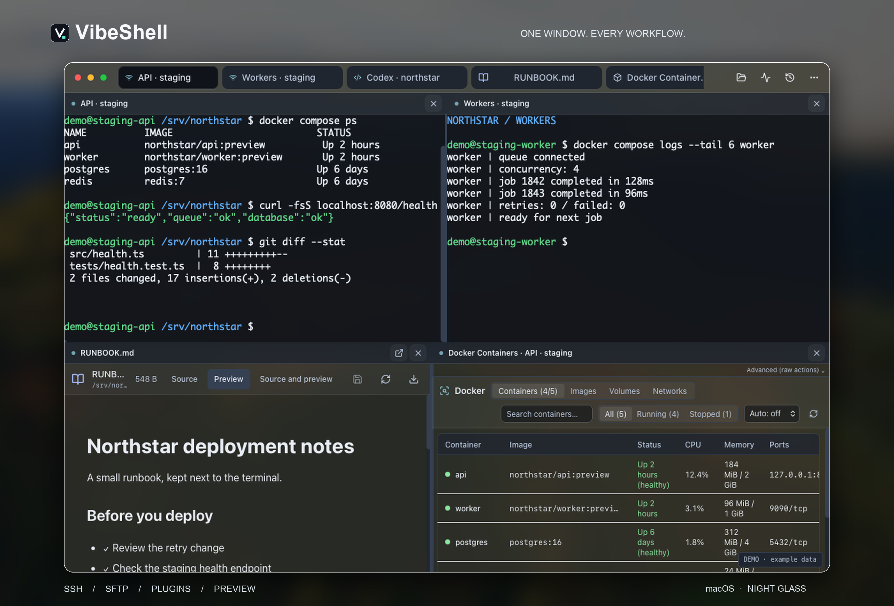
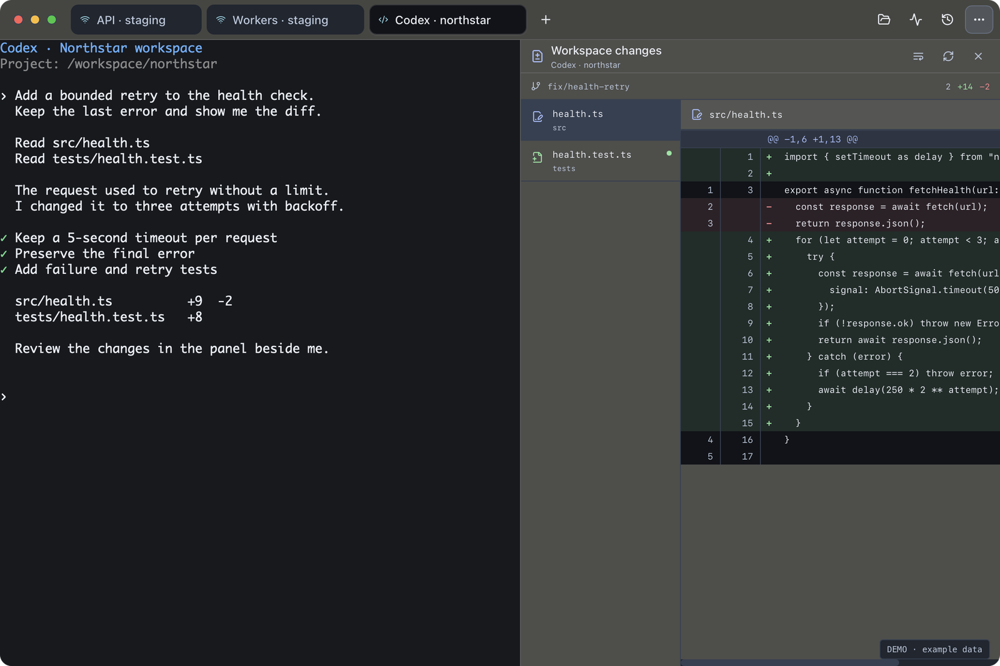

<p align="center">
  
</p>

<p align="center">
  <a href="README.md">English</a> · <a href="README.zh-CN.md">简体中文</a> · <a href="README.ja.md">日本語</a>
</p>
<p align="center">
  <a href="https://github.com/veithly/vibeshell/releases"></a>
  <a href="LICENSE"></a>
</p>
<p align="center">
  <a href="https://github.com/veithly/vibeshell/releases"><strong>下载安装</strong></a> · <a href="#ai-integration">AI 接入</a> · <a href="#ssh-workspace">SSH 工作台</a> · <a href="#start-here">快速上手</a> · <a href="cli/README.md">CLI 指南</a> · <a href="docs/FEATURES.md">完整功能</a>
</p>

<p align="center"><sub>支持社区 · <a href="https://linux.do">linux.do</a></sub></p>

**AI 工具无缝接入，自己用也爱不释手的 SSH 终端管理工具。**

VibeShell 把服务器管理、SSH 会话、SFTP 和运维插件连成一套工作流：让 Claude Code、Codex、Cursor 等 AI 工具通过 Skill 与原生 CLI 操作已保存的服务器；你也能在同一个工作区里查看执行过程，随时亲自接手。

**交给 AI，不必来回复制命令和输出；自己上手，不必在终端、文件传输和监控工具之间反复切换。**



<a id="ai-integration"></a>
## 让你常用的 AI，直接用上 SSH 工作台

### 接上已有 AI 工具，不必换工作流

VibeShell 不要求你换一个聊天客户端。给现有工具安装 **VibeShell Skill**，Agent 就能按说明调用原生 CLI：发现已保存的服务器、复用 SSH 会话、查询日志、读写远程文件、传输目录，以及发现和执行运维插件。

内置 Skill 安装入口覆盖 **Claude Code、Codex、Cursor、OpenCode、Pi、Gemini CLI、Windsurf** 等工具。使用你自己的 AI 工具、登录和模型配置；服务器连接由 VibeShell 管理，不用把 SSH 密码或私钥贴进对话。

安装 VibeShell 后，在 **设置 → 技能** 中选择目标工具安装；也可以用 CLI 检查并安装，例如接入 Claude Code：

```bash
vibeshell version
vibeshell tools
vibeshell install claude-code
```

其他工具使用 `tools` 列出的 ID，例如 `codex`、`cursor` 或 `opencode`；`vibeshell install all` 可为检测到的工具批量安装。让目标客户端加载新 Skill 后，就可以这样交代任务：

> 用 VibeShell 检查已保存的 staging 服务器：复用现有会话，查看服务状态和最近的错误日志，先给我排查结论，不要重启服务。

需要协议级接入时，本地 **MCP 网关**也提供会话、文件与插件工具。原生 CLI 可脱离桌面独立运行，不依赖 Node.js。[接入与协作说明](docs/AGENT_COLLABORATION.md) · [Agent Skill](skills/vibeshell/SKILL.md) · [CLI 指南](cli/README.md)

<a id="shared-sessions"></a>
### AI 在操作，你能看见，也能接手

**不是让 AI 在另一个看不见的终端里忙。** 通过 CLI 的 `ssh` / `ssh-session`，Agent 可以复用你正在用的交互式 SSH 会话；命令和输出在桌面终端可见，`cd`、`export` 的上下文继续保留。需要独立并行工作时，再用 `--new` 新建会话。

历史面板用不同颜色区分 **User** 与 **Agent（CLI）**，记录关联具体会话，点击即可返回。Agent 新建的连接会出现为独立标签，不抢走你正在看的页面。你可以先手动定位问题，再交给 AI 继续分析；也可以看着它执行，然后自己接着操作。

需要确认的受保护 Gateway 操作会进入审批流程。MCP 与插件的独立执行不等于共享交互 Shell，具体上下文和权限规则见[协作指南](docs/AGENT_COLLABORATION.md)。

### 编程 Agent、终端和代码审阅，放在一起

本地开发时，从 **＋ → Coding Agent** 启动 **Claude Code、Codex、OpenCode 或 Pi**，选择项目、任务和工具支持的启动模式。旁边打开 **工作区变更**，查看 Git 分支、修改文件和逐行差异；SSH 终端与远程文件仍可放在同一个工作区，方便衔接开发和运维。



<a id="ssh-workspace"></a>
## 不开 AI，它也是你的主力 SSH 终端

**AI 是加成，不是使用门槛。** 多会话 SSH、连接管理、SFTP、命令补全、运维面板和隧道都能独立使用；日常连服务器、改配置、看日志，不需要先配置模型或 AI 账号。

**服务器多，也能找得快。** 按名称搜索，用分组和标签区分环境；导入 OpenSSH、PuTTY、Tabby 配置，保留跳板机等连接信息。返回已有会话与新建连接有独立入口，不必每次重新填写 IP 和登录参数。

### 一个主窗口，自由组合多个工作面板

左边同时查看两台服务器的终端，右边打开 Markdown 操作手册和 Docker 插件。**这些都是同一个大窗口里的独立工作区域**，既能同时观察，也能分别操作，不必在多个页面间来回切换。

- **不同类型混排。** 一个窗格是 SSH 终端，另一个可以是本地 Shell、运维插件、代码编辑器、Markdown 或文件预览。
- **按任务拼接布局。** 将标签拖到窗格边缘即可左右或上下分栏，拖动分隔线调整大小，最多组合九个窗格。
- **每块面板各做各的事。** 并排查看不同服务器的输出，或一边执行命令、一边查看配置和运行状态。
- **布局和编辑内容都保留。** 自动保存分栏布局；移动文档不会丢失未保存的修改。


[了解多分栏布局与拖拽操作](docs/window-management.md)

### 少记几个参数，少敲几遍命令

忘记子命令或选项时，不用先切出去搜索。VibeShell 会在输入位置显示**命令、子命令、参数说明和历史候选**，支持模糊匹配与行内提示；常用命令还能保存为可搜索的片段。

| 快捷操作 | 用法 |
| --- | --- |
| `Ctrl+Space` | 在当前输入处打开或关闭补全列表 |
| `↑` / `↓` | 在补全列表中选择候选 |
| `Tab` | 接受选中的补全 |
| `→` | 接受行内后缀提示 |
| `Esc` | 收起补全列表 |


本地补全不需要 AI 账号。需要更灵活的建议时，可在设置中接入自己的 OpenAI 兼容或 Claude 接口，开启 **AI 指令预测**。预测只提供建议，不会自动执行；启用后会将当前输入和近期命令上下文发送给所选服务。

### SFTP 不只是传文件：直接改、直接看、直接解压

打开文件夹图标就能浏览当前服务器的文件。**双击文件进入工作区，修改后直接保存回服务器**，不用先下载、换编辑器、再上传。

| 你想做什么 | 直接在 VibeShell 里完成 |
| --- | --- |
| 修改配置、脚本和代码 | 独立编辑标签、语法高亮、`⌘/Ctrl+S` 保存 |
| 阅读 README 或操作手册 | Markdown 源码、预览、源码与预览并排 |
| 检查图片、PDF、音视频 | 在文件标签中直接预览，支持的格式随平台解码能力而定 |
| 先看看压缩包里有什么 | 浏览 ZIP、TAR、TAR.GZ 的文件目录 |
| 解压远端部署包 | 选中压缩包，右键 **Extract here**，在当前服务器目录解压 |
| 把几个文件一起打包 | 多选后压缩为 `.tar.gz` 或 `.zip` |
| 整理和传输文件 | 详情 / 分栏 / 图标视图，多选、复制路径、重命名、新建目录、上传和下载 |
| 同步项目目录 | 排除规则、嵌套 `.gitignore`，可选择清理远端多余文件 |


远端解压支持常见 TAR、ZIP、GZ、BZ2、XZ、7z 和 RAR 格式，调用服务器上对应的解压工具。**压缩包目录预览与远端解压是两项独立功能。**

本地文件同样可以用 **⌘/Ctrl+O** 打开。编辑器会保留草稿，保存本地文件时检查外部修改，减少误覆盖；操作手册、远程配置和本地笔记可以一起放进工作区。

<details>
<summary>查看 Markdown 源码与预览并排</summary>


</details>

### 终端下方看性能，服务详情用面板

点击性能图标，**CPU、内存、磁盘和网络面板就在终端下方展开**。不用离开当前命令，拖动边界即可调整高度，再点一次收起。

需要深入检查时，在当前会话打开内置工具：看 Docker 日志和容器状态，浏览数据库，检查端口，或管理服务与定时任务。

<details>
<summary>查看全部 12 个内置运维插件</summary>

| 内置工具 | 常用功能 |
| --- | --- |
| 服务器性能 | 资源使用、负载、运行时间与定时刷新 |
| Docker 容器 | 运行 / 停止筛选、资源指标、日志、inspect、启停、重启、一次性 exec |
| Kubernetes | 上下文、Pod、Deployment、事件、日志与 describe |
| 数据库检查 | PostgreSQL、MySQL、SQLite 的元数据和查询 |
| Redis 检查 | 键查找、内容、类型、TTL、客户端、慢日志与配置 |
| 进程查看 | 按 CPU / 内存排序、详情和终止进程 |
| 系统日志 | 近期日志与指定服务日志 |
| 网络检查 | 监听端口、路由、网卡与 DNS |
| 磁盘使用 | 文件系统容量和目录占用 |
| Git 工作区 | 状态、分支与提交历史 |
| 计划任务 | cron、systemd timers 与用户任务编辑 |
| Systemd 服务 | 状态查看、启动、停止与重启 |

</details>


这 **12 个内置插件**也能通过 CLI 和 MCP 被 Agent 发现和使用；插件市场支持导入声明式 JSON 插件。各工具需要目标环境中相应的程序和权限，[插件参考](docs/FEATURES.md#operations-plugins)列出了具体依赖。

### 常用操作和个人习惯，都照顾到

**常用操作不再反复输入。** 命令片段按分类和标签保存；本地转发、反向转发和 SOCKS5 隧道可以保存配置；SSH 输出可录制为本地日志。

**换设备也能带走配置。** 可选的 GitHub Gist / WebDAV 加密同步，以及便携文件导入导出，帮助迁移服务器资料、分组、片段和插件记录；登录凭据仍留在本机。

**外观按你的习惯来。** 日间、夜间和跟随系统，字体、字号、光标以及独立的终端底色与窗体浓度控制。macOS 支持原生半透明毛玻璃；还可以预览、导入和保存自己的 CSS 主题。

<details>
<summary>查看最新外观设置</summary>


</details>

<a id="start-here"></a>
## 开始使用

从 [Releases](https://github.com/veithly/vibeshell/releases) 下载对应平台版本：

| 平台 | 桌面端 | 独立 CLI |
| --- | --- | --- |
| macOS Apple Silicon / Intel | `.dmg` | 对应架构 `.tar.gz` |
| Windows x64 | `.exe` / `.msi` | `.zip` |
| Linux x64 | `.AppImage` / `.deb` | `.tar.gz` |

桌面端点击 **＋ → SSH** 添加或选择服务器，核对首次连接指纹后即可开始。**本地 Shell** 和 **Coding Agent** 也在同一个新建入口中。

准备把 AI 也接进来？完成服务器配置后，按上面的 [AI 接入](#ai-integration) 安装 Skill，就能让它使用这些服务器与会话。

原生 CLI 不依赖 Node.js，也可在没有桌面的环境中使用。安装后，先导入已有配置，再选择服务器：

```bash
vibeshell import auto --dry-run
vibeshell import auto
vibeshell servers
vibeshell servers add user@host --name staging --identity ~/.ssh/id_ed25519
vibeshell ssh staging
```

把 `staging` 换成你的服务器名。用 `sessions` 返回的别名继续操作同一会话：

```bash
vibeshell sessions
vibeshell ssh-session 001 -- pwd
vibeshell sftp --session 001 ls /srv/app
vibeshell plugins list --installed --json
```

[CLI 安装和更多命令](cli/README.md) · [功能与平台说明](docs/FEATURES.md) · [更新记录](CHANGELOG.md)

### 容器会话与网络设置

**容器也能单独开终端。** 在 SSH 会话的 **更多 → Docker containers** 中选择运行中的容器，终端、原生 CLI、MCP 和插件命令会保持在该容器内；已停止的容器不会被自动启动。设置中还可配置 HTTP/HTTPS/SOCKS 出站代理和固定 Agent Gateway 端口。[配置方法与支持范围](docs/NETWORK_AND_CONTAINERS.md)。

### Teleport 节点

开发分支支持在桌面和原生 `vibeshell` CLI 中管理 Teleport 连接。先用 `tsh` 登录，再执行 `vibeshell servers add alice@node --type teleport --proxy proxy.example:443`，即可沿用终端、命令和文件工作流。文件操作要求节点提供可执行的标准 SFTP 服务端；不支持的配置会明确报错。[配置方法与支持范围](docs/TELEPORT.md)。

<a id="development"></a>
## 开发与贡献

需要 Node.js 22.12+、稳定版 Rust 和 [Tauri 平台依赖](https://v2.tauri.app/start/prerequisites/)。

```bash
git clone --branch dev https://github.com/veithly/vibeshell.git
cd vibeshell
npm ci
npm run tauri -- dev
```

普通 PR 提交到 `dev`。构建、测试和发布说明见[贡献指南](CONTRIBUTING.md)与[发布流程](docs/RELEASING.md)。

[完整功能](docs/FEATURES.md) · [窗口管理](docs/window-management.md) · [文件与主题](docs/local-files-and-css-themes.md) · [插件开发](docs/plugin-development.md) · [安全问题报告](https://github.com/veithly/vibeshell/security/advisories/new)

*截图使用最新开发界面与示例数据；安装包功能以对应发行说明为准。[截图素材与复现](assets/readme/README.md)。*

## 许可证

**GPL-3.0-only**。详见 [LICENSE](LICENSE)、[NOTICE](NOTICE) 与[保留的 MIT 声明](licenses/legacy-MIT.txt)。
