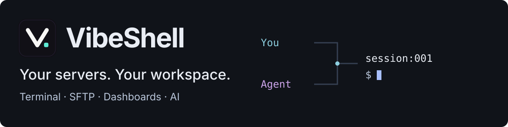
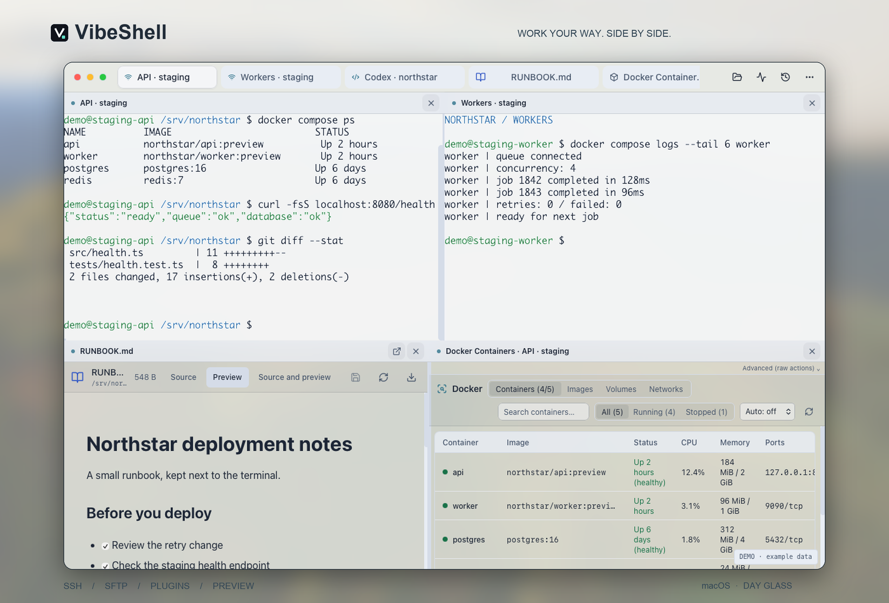
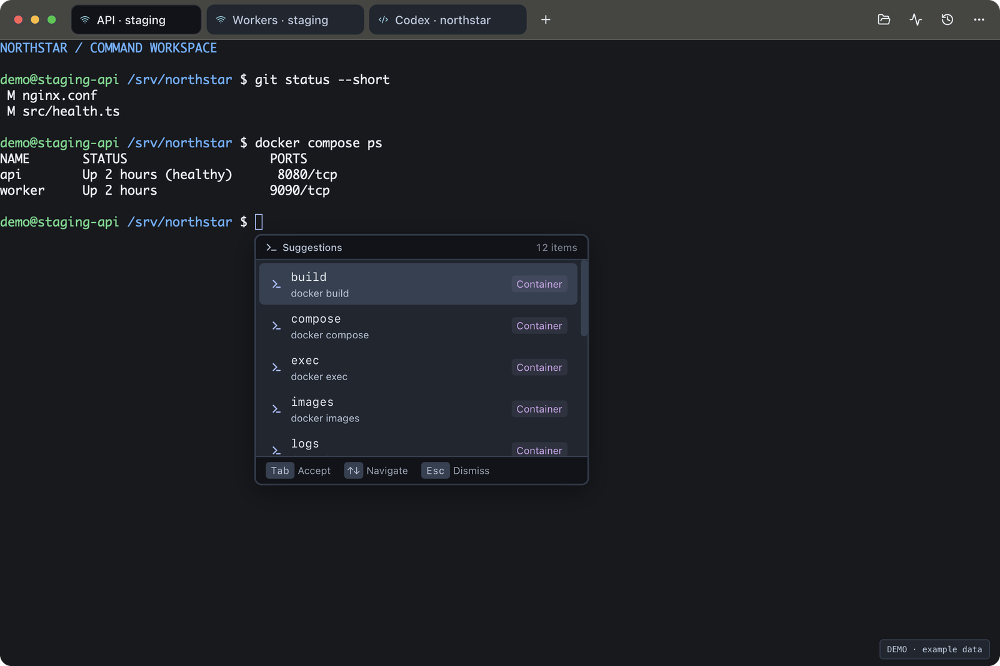
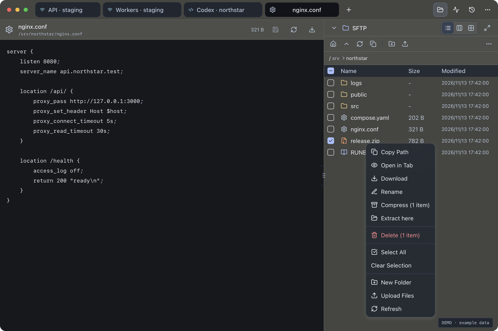
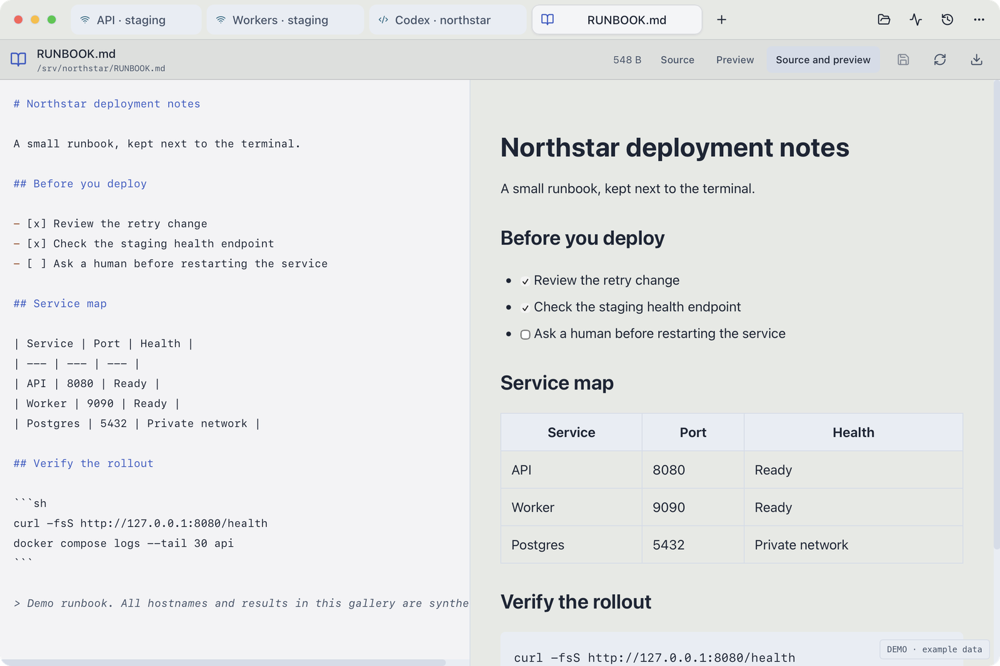
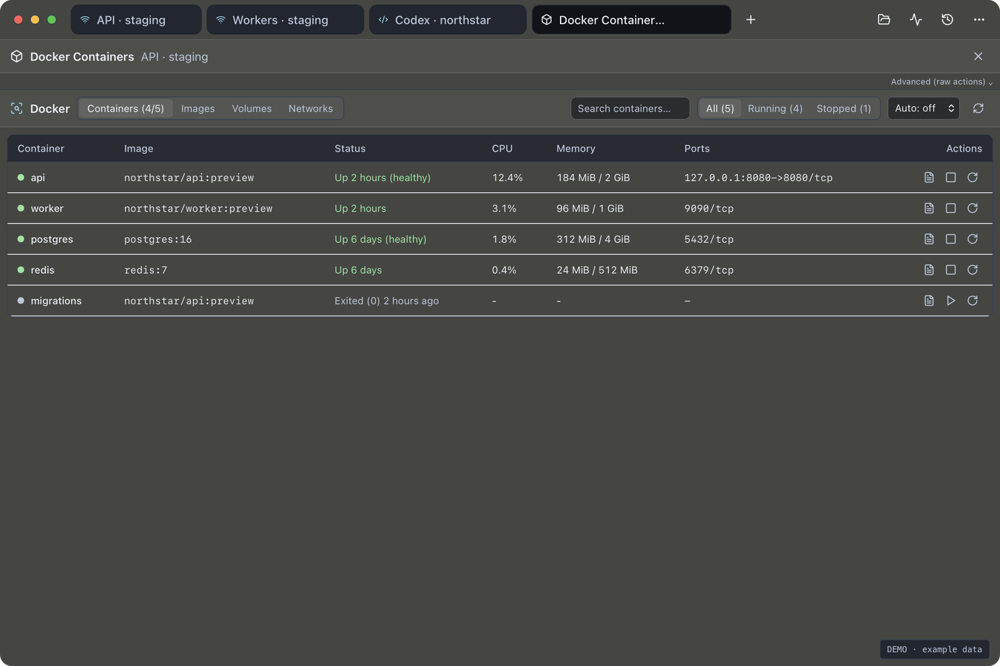
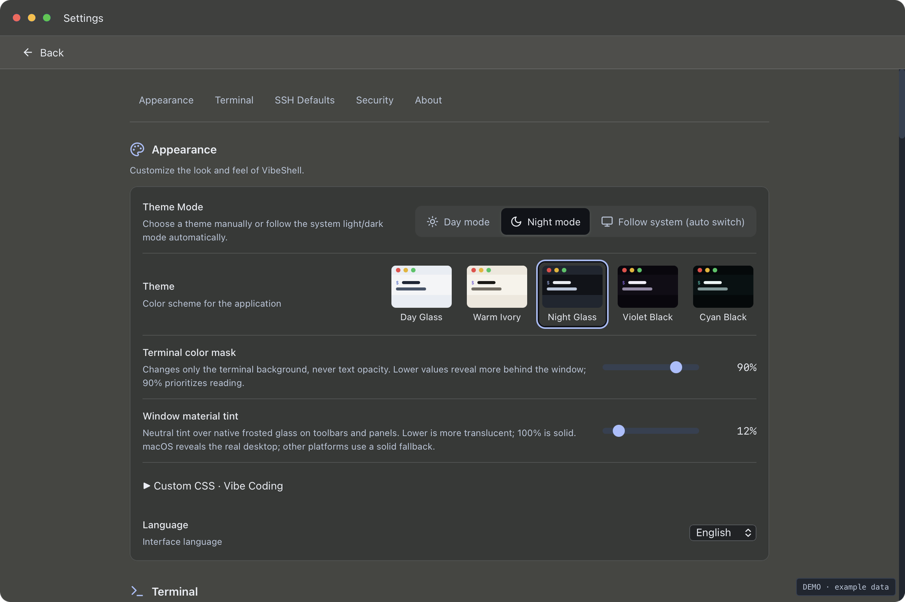

<p align="center">
  
</p>

<p align="center">
  <a href="README.md">English</a> · <a href="README.zh-CN.md">简体中文</a> · <a href="README.ja.md">日本語</a>
</p>
<p align="center">
  <a href="https://github.com/veithly/vibeshell/releases"></a>
  <a href="LICENSE"></a>
</p>
<p align="center">
  <a href="https://github.com/veithly/vibeshell/releases"><strong>下载安装</strong></a> · <a href="#start-here">快速上手</a> · <a href="cli/README.md">CLI 指南</a> · <a href="docs/FEATURES.md">完整功能</a>
</p>

<p align="center"><sub>支持社区 · <a href="https://linux.do">linux.do</a></sub></p>

**VibeShell 是把 SSH、本地终端、SFTP 和 AI 协作放在一起的桌面工作区。** 一边看日志，一边改配置；输入命令时查看提示，选中文件即可编辑、预览或解压。**一个主窗口里就能同时摆下多个终端、插件和文件预览**，不用反复切换页面。


## 一个主窗口，自由组合多个工作面板

左边同时查看两台服务器的终端，右边打开 Markdown 操作手册和 Docker 插件。**这些都是同一个大窗口里的独立工作区域**，既能同时观察，也能分别操作，不必在多个页面间来回切换。

- **不同类型混排。** 一个窗格是 SSH 终端，另一个可以是本地 Shell、运维插件、代码编辑器、Markdown 或文件预览。
- **按任务拼接布局。** 将标签拖到窗格边缘即可左右或上下分栏，拖动分隔线调整大小，最多组合九个窗格。
- **每块面板各做各的事。** 并排查看不同服务器的输出，或一边执行命令、一边查看配置和运行状态。
- **布局和编辑内容都保留。** 自动保存分栏布局；移动文档不会丢失未保存的修改。



[了解多分栏布局与拖拽操作](docs/window-management.md)

## 少记几个参数，少敲几遍命令

忘记子命令或选项时，不用先切出去搜索。VibeShell 会在输入位置显示**命令、子命令、参数说明和历史候选**，支持模糊匹配与行内提示；常用命令还能保存为可搜索的片段。

| 快捷操作 | 用法 |
| --- | --- |
| `Ctrl+Space` | 在当前输入处打开或关闭补全列表 |
| `↑` / `↓` | 在补全列表中选择候选 |
| `Tab` | 接受选中的补全 |
| `→` | 接受行内后缀提示 |
| `Esc` | 收起补全列表 |



本地补全不需要 AI 账号。需要更灵活的建议时，可在设置中接入自己的 OpenAI 兼容或 Claude 接口，开启 **AI 指令预测**。预测只提供建议，不会自动执行；启用后会将当前输入和近期命令上下文发送给所选服务。

## SFTP 不只是传文件：直接改、直接看、直接解压

打开文件夹图标就能浏览当前服务器的文件。**双击文件进入工作区，修改后直接保存回服务器**，不用先下载、换编辑器、再上传。

| 你想做什么 | 直接在 VibeShell 里完成 |
| --- | --- |
| 修改配置、脚本和代码 | 独立编辑标签、语法高亮、`⌘/Ctrl+S` 保存 |
| 阅读 README 或操作手册 | Markdown 源码、预览、源码与预览并排 |
| 检查图片、PDF、音视频 | 在文件标签中直接预览，支持的格式随平台解码能力而定 |
| 先看看压缩包里有什么 | 浏览 ZIP、TAR、TAR.GZ 的文件目录 |
| 解压远端部署包 | 选中压缩包，右键 **Extract here**，在当前服务器目录解压 |
| 把几个文件一起打包 | 多选后压缩为 `.tar.gz` 或 `.zip` |
| 整理和传输文件 | 详情 / 分栏 / 图标视图，多选、复制路径、重命名、新建目录、上传和下载 |
| 同步项目目录 | 排除规则、嵌套 `.gitignore`，可选择清理远端多余文件 |



远端解压支持常见 TAR、ZIP、GZ、BZ2、XZ、7z 和 RAR 格式，调用服务器上对应的解压工具。**压缩包目录预览与远端解压是两项独立功能。**

本地文件同样可以用 **⌘/Ctrl+O** 打开。编辑器会保留草稿，保存本地文件时检查外部修改，减少误覆盖；操作手册、远程配置和本地笔记可以一起放进工作区。

<details>
<summary>查看 Markdown 源码与预览并排</summary>



</details>

## 终端下方看性能，服务详情用面板

点击性能图标，**CPU、内存、磁盘和网络面板就在终端下方展开**。不用离开当前命令，拖动边界即可调整高度，再点一次收起。

需要深入检查时，在当前会话打开内置工具：看 Docker 日志和容器状态，浏览数据库，检查端口，或管理服务与定时任务。

| 内置工具 | 常用功能 |
| --- | --- |
| 服务器性能 | 资源使用、负载、运行时间与定时刷新 |
| Docker 容器 | 运行 / 停止筛选、资源指标、日志、inspect、启停、重启、一次性 exec |
| Kubernetes | 上下文、Pod、Deployment、事件、日志与 describe |
| 数据库检查 | PostgreSQL、MySQL、SQLite 的元数据和查询 |
| Redis 检查 | 键查找、内容、类型、TTL、客户端、慢日志与配置 |
| 进程查看 | 按 CPU / 内存排序、详情和终止进程 |
| 系统日志 | 近期日志与指定服务日志 |
| 网络检查 | 监听端口、路由、网卡与 DNS |
| 磁盘使用 | 文件系统容量和目录占用 |
| Git 工作区 | 状态、分支与提交历史 |
| 计划任务 | cron、systemd timers 与用户任务编辑 |
| Systemd 服务 | 状态查看、启动、停止与重启 |



这 **12 个内置插件**也能通过 CLI 和 MCP 被 Agent 发现和使用；插件市场支持导入声明式 JSON 插件。各工具需要目标环境中相应的程序和权限，[插件参考](docs/FEATURES.md#operations-plugins)列出了具体依赖。

<a id="shared-sessions"></a>
## 你和 Agent，接着同一份工作往下做

让 Agent 检查日志，你不用再把终端输出复制过去；它通过 VibeShell CLI 使用已有会话，**命令和输出仍在你看得到的终端里**。`cd` 和 `export` 的上下文继续保留，只有明确使用 `--new` 才另开 Shell。

**谁做了什么，一眼能分清。** 历史面板用不同颜色区分 User 与 Agent（CLI），每条记录关联具体会话；点击记录中的会话就能返回。Agent 新建连接会出现为独立标签，不抢走你正在看的页面。

本地开发则可以直接启动 **Claude Code、Codex、OpenCode 或 Pi**：选项目、填任务、选择工具支持的启动模式，再打开**工作区变更**检查分支和逐行差异。已有工具的安装、登录和订阅继续使用你自己的配置。


命令审批会展示需要确认的操作与原因，由你决定是否继续。普通 SSH、文件和运维功能都可以独立使用，不必启用 AI。[Agent Skill](skills/vibeshell/SKILL.md) · [协作指南](docs/AGENT_COLLABORATION.md)

## 把日常重复操作交给工具

**连接不用从头配置。** 按名称搜索服务器，用分组和标签整理环境；支持从 OpenSSH、PuTTY、Tabby 导入配置，以及跳板机和登录后命令。返回已有会话与新建连接有独立入口。

**常用操作不再反复输入。** 命令片段按分类和标签保存；本地转发、反向转发和 SOCKS5 隧道可以保存配置；SSH 输出可录制为本地日志。

**换设备也能带走配置。** 可选的 GitHub Gist / WebDAV 加密同步，以及便携文件导入导出，帮助迁移服务器资料、分组、片段和插件记录；登录凭据仍留在本机。

**外观按你的习惯来。** 日间、夜间和跟随系统，字体、字号、光标以及独立的终端底色与窗体浓度控制。macOS 支持原生半透明毛玻璃；还可以预览、导入和保存自己的 CSS 主题。

<details>
<summary>查看最新外观设置</summary>



</details>

<a id="start-here"></a>
## 开始使用

从 [Releases](https://github.com/veithly/vibeshell/releases) 下载对应平台版本：

| 平台 | 桌面端 | 独立 CLI |
| --- | --- | --- |
| macOS Apple Silicon / Intel | `.dmg` | 对应架构 `.tar.gz` |
| Windows x64 | `.exe` / `.msi` | `.zip` |
| Linux x64 | `.AppImage` / `.deb` | `.tar.gz` |

桌面端点击 **＋ → SSH** 添加或选择服务器，核对首次连接指纹后即可开始。**本地 Shell** 和 **Coding Agent** 也在同一个新建入口中。

原生 CLI 不依赖 Node.js，也可在没有桌面的环境中使用。安装后，先导入已有配置，再选择服务器：

```bash
vibeshell import auto --dry-run
vibeshell import auto
vibeshell servers
vibeshell ssh staging
```

把 `staging` 换成你的服务器名。用 `sessions` 返回的别名继续操作同一会话：

```bash
vibeshell sessions
vibeshell ssh-session 001 -- pwd
vibeshell sftp --session 001 ls /srv/app
vibeshell plugins list --installed --json
```

[CLI 安装和更多命令](cli/README.md) · [功能与平台说明](docs/FEATURES.md) · [更新记录](CHANGELOG.md)

<a id="development"></a>
## 开发与贡献

需要 Node.js 22.12+、稳定版 Rust 和 [Tauri 平台依赖](https://v2.tauri.app/start/prerequisites/)。

```bash
git clone --branch dev https://github.com/veithly/vibeshell.git
cd vibeshell
npm ci
npm run tauri -- dev
```

普通 PR 提交到 `dev`。构建、测试和发布说明见[贡献指南](CONTRIBUTING.md)与[发布流程](docs/RELEASING.md)。

[完整功能](docs/FEATURES.md) · [窗口管理](docs/window-management.md) · [文件与主题](docs/local-files-and-css-themes.md) · [插件开发](docs/plugin-development.md) · [安全问题报告](https://github.com/veithly/vibeshell/security/advisories/new)

*截图使用最新开发界面与示例数据；安装包功能以对应发行说明为准。[截图素材与复现](assets/readme/README.md)。*

## 许可证

**GPL-3.0-only**。详见 [LICENSE](LICENSE)、[NOTICE](NOTICE) 与[保留的 MIT 声明](licenses/legacy-MIT.txt)。
